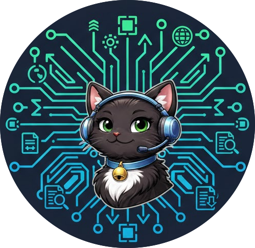
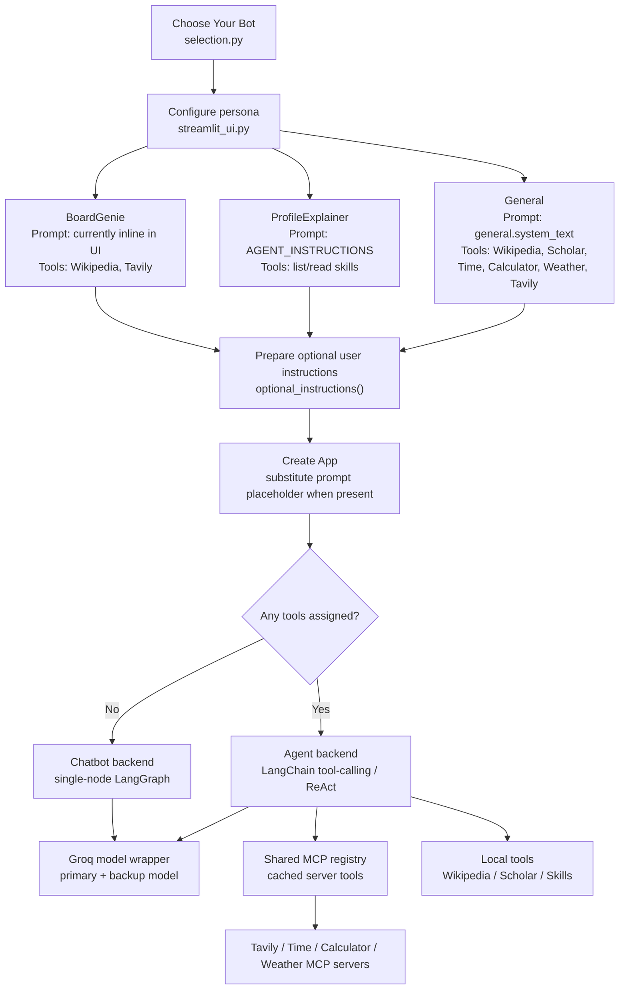

<p align="center">
  
</p>

# Agentic_Workflow
"Catbot" — a Streamlit app with three chat personas (General, ProfileExplainer, BoardGenie), built on LangGraph/LangChain, Groq-hosted LLMs, and FastMCP tool servers.

## What this repo contains
- `src/UI/streamlit_ui.py`: the Streamlit app — bot selection screen, per-bot config, and chat.
- `src/agents/General/`, `src/agents/ProfileExplainer/`, `src/agents/BoardGenie/`: one system-prompt module + one tools module per persona.
- `src/agents_utils/chatbot.py`, `src/agents_utils/agent.py`: the two backends (`Chatbot` for tool-less personas, `Agent`/ReAct for personas with tools) wrapped by `src/app.py`'s `App`.
- `src/tools/mcp_registry.py`: shared, cached MCP (FastMCP stdio) server registry used by all three personas so a server like Tavily only ever spins up once.
- `src/mcp_servers/`: the FastMCP servers themselves (Tavily web search, time, calculator, weather).
- `src/llm_chats/Chatgroq.py`: Groq LLM wrapper with primary/backup model fallback, used by every agent/chatbot.
- `notebooks/chatbot_agent_example.ipynb`: standalone guided examples showing `Chatbot` and `Agent` usage outside the Streamlit app.

## Codebase structure

```text
.
├── start.py                         # Streamlit entry point
├── requirements.txt                 # Python dependencies
├── src/
│   ├── app.py                        # Selects Chatbot or tool-enabled Agent
│   ├── agents/
│   │   ├── General/                  # General prompt and tool bundle
│   │   ├── ProfileExplainer/         # Profile prompt and skill tools
│   │   ├── BoardGenie/               # Board-game prompt and game tools
│   │   └── skills/                   # Markdown knowledge/skill files
│   ├── agents_utils/
│   │   ├── agent.py                  # LangChain tool-calling agent backend
│   │   ├── chatbot.py                # Tool-less LangGraph chatbot backend
│   │   └── multimodal_agent.py       # Reserved/incomplete multimodal agent
│   ├── llm_chats/Chatgroq.py         # Groq model wrapper and fallback
│   ├── mcp_servers/                  # Individual FastMCP server processes
│   ├── tools/                        # Knowledge, PDF, skill, and MCP utilities
│   ├── UI/
│   │   ├── streamlit_ui.py           # Picker, per-persona setup, and chat screen
│   │   ├── components/selection.py   # Persona card picker
│   │   └── static/                   # Persona themes and UI assets
│   ├── utils/                        # Logging, prompt validation, streaming helpers
│   └── workflows/                    # Future custom multi-agent graphs
├── notebooks/                        # Guided usage examples
├── Examples/                         # Standalone examples
└── ideas.txt                         # Product and architecture roadmap
```

## UI picker → prompt, tools, and agent flow

The selection screen in `src/UI/components/selection.py` returns the chosen persona. The main UI then adds that persona's configuration and connects its prompt and tools before creating the session. The current mapping is:

| Picker option | Prompt passed to `App` | Tools assigned by the UI |
| --- | --- | --- |
| General | `src/agents/General/general.py` → `system_text` | Wikipedia + Semantic Scholar; time, calculator, weather, and Tavily MCP tools |
| ProfileExplainer | `src/agents/ProfileExplainer/profile_explainer.py` → `AGENT_INSTRUCTIONS` | Skill discovery and skill-reading tools from `src/tools/skill_utils.py`; no MCP servers |
| BoardGenie | Inline prompt in `src/UI/streamlit_ui.py` | Tavily web search MCP tool + Wikipedia |

The BoardGenie prompt module at `src/agents/BoardGenie/board_genie.py` already contains the fuller board-game companion prompt, but the current picker flow uses an inline prompt instead. Wire the module into the UI if that fuller prompt is intended to be active.



All three currently selected personas receive tools, so they use the `Agent` backend. The `Chatbot` path remains available for a future tool-less persona. MCP tools are supplied by `src/tools/mcp_registry.py`; knowledge and skill tools are assembled in each persona's tools module.

## Tech stack
- **Language:** Python 3.11+
- **Core libs:** `langgraph`, `langchain`/`langchain-core`, `langchain-groq`, `langchain-mcp-adapters`, `fastmcp`, `streamlit`, `tavily-python` and ecosystem packages listed in `requirements.txt`.

## Quickstart (Windows PowerShell)
```powershell
# create virtual env
python -m venv venv
.\venv\Scripts\Activate.ps1
# install dependencies
pip install -r requirements.txt
# set GROQ_API_KEY, TAVILY_API_KEY, etc. in a .env file at the repo root
# run the app (Streamlit UI on port 8505)
python start.py
```

## Examples
- Run `python start.py` to use the three personas through the Streamlit UI.
- Open `notebooks/chatbot_agent_example.ipynb` to see `Chatbot`/`Agent` used standalone, outside the app.
- See `src/agents/` for each persona's prompt + tools, and `src/mcp_servers/` for the MCP servers they share via `src/tools/mcp_registry.py`.


## Quick examples

- Chatbot (synchronous):

```python
from src.backend.agents_utils import Chatbot

bot = Chatbot(system_text="You are a helpful assistant that tells everything in jokes.", show_graph=False)
messages = []
response, messages = bot.ask(query="Tell me about LOTR", messages=messages)
print(response)
```

- Chatbot (streaming):

```python
# uses the same `bot` and `messages` as above
bot.stream_ask(query="Great, thanks", messages=messages)
```

- Agent with a simple tool (async):

```python
from src.backend.agents_utils.agent import Agent
import asyncio


def calculate_age(birth_date: str, target_date: str | None = None) -> str:
    # minimal shim; see `notebooks/chatbot_agent_example.ipynb` for full function
    return f"Age calculator received: {birth_date} -> {target_date or 'today'}"


agent = Agent(system_text="You are a helpful assistant that can use tools.", tools=[calculate_age], show_graph=False)


async def run():
    messages = []
    response, messages = await agent.stream_ask("My birthday is 1991-12-20. Tell me interesting insights",
                                                messages=messages, mode="updates")
    print(response)


asyncio.run(run())
```

See `notebooks/chatbot_agent_example.ipynb` for the full `calculate_age` implementation and more usage patterns.
